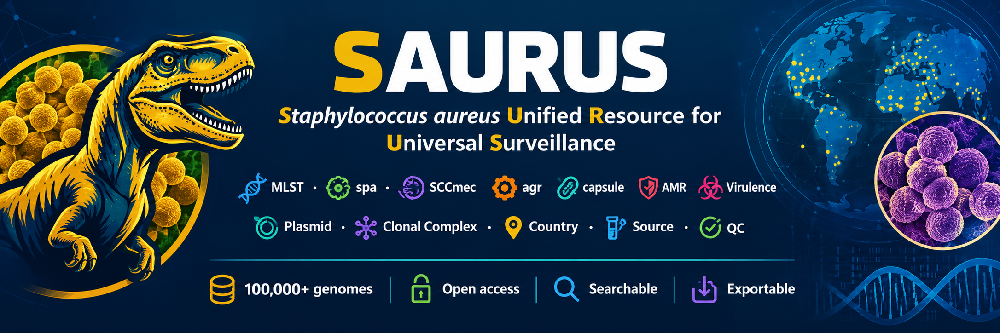

<div align="center">



# 🦖 SAURUS

**Staphylococcus aureus Unified Resource for Universal Surveillance**

*One database. Every typing module. Every genome geolocated. Every interface, web and terminal.*

[](https://saurus-db.org/)
[](https://github.com/bbeckley-hub/saurus/releases)
[](https://saurus-db.org/)
[](https://saurus-db.org/)
[](https://saurus-db.org/)
[](https://saurus-db.org/geography.html)
[](https://pypi.org/project/saurus-cli/)
[](https://anaconda.org/bioconda/saurus-cli)
[](https://github.com/bbeckley-hub/saurus-cli/pkgs/container/saurus-cli)
[](LICENSE)
[](https://argus-db.org/)
[](https://doi.org/10.5281/zenodo.23264894)

[**🏠 Home**](https://saurus-db.org/) ·
[**🌍 Geography**](https://saurus-db.org/geography.html) ·
[**🧬 Lineages**](https://saurus-db.org/lineages.html) ·
[**📥 Downloads**](https://saurus-db.org/downloads.html) ·
[**💻 CLI Manual**](https://saurus-db.org/manual.html) ·
[**ℹ️ About**](https://saurus-db.org/about.html)

</div>


---

## 🚨 The Problem: Genomic Data Is Public, but Genomic Retrieval Is Still Manual

We now have **134,160 fully typed public *Staphylococcus aureus* genomes**. The raw data exists. The annotations exist. The epidemiological metadata exists. And yet the most routine question in genomic epidemiology still requires a script.

Ask for *"all ST5 MRSA bloodstream isolates from the United States between 2015 and 2023 carrying mecA"* and watch what happens:

- You download typing tables from one source.
- You download gene presence/absence from another.
- You download NCBI BioSample metadata from a third.
- You write custom Python to cross-reference accessions.
- You reconcile column names, accession formats, and version suffixes.
- You iterate until the join doesn't silently drop records.
- **Then** you get your accession list.

That is not a data problem. That is an **interface problem**, and it is why the majority of researchers, clinicians, and public health teams who *should* be doing genomic surveillance are locked out of it. The data is free; the workflow is not.

---

## 💡 The Solution: SAURUS, Two Ways

**SAURUS** compiles eleven typing, gene-annotation, and epidemiological modules for the entire public *S. aureus* repository into a **single, queryable interface**. You can query it however you already work:

<table>
<tr>
<td width="50%" valign="top" align="center">

### 🌐 **Web UI**
**https://saurus-db.org**

Point, click, filter, export.
No install. Runs in your browser.

[**→ Open the web app**](https://saurus-db.org/)

</td>
<td width="50%" valign="top" align="center">

### 💻 **SAURUS-CLI**
`pip install saurus-cli`

Terminal-native. Pipeline-ready.
Bundled data, zero downloads.

[**→ Read the CLI manual**](https://saurus-db.org/manual.html)

</td>
</tr>
</table>

Both interfaces expose the same 11 modules, the same 134,160 genomes, the same epidemiological metadata, and both produce the same artifact: **a clean accession list** ready to feed directly to `datasets download genome accession` or `fastq-dl`.

| Category | Modules |
|---|---|
| **Typing** | MLST · spa · SCCmec (CGE + RPet) · agr · capsule |
| **Genes** | AMR · Virulence (VFDB) · Plasmid replicons |
| **Clinical** | MRSA/MSSA consensus |
| **Epidemiology** | Country · isolation source · host · collection year · BioProject · BioSample |
| **Raw reads** | SRA Run · BioSample · BioProject exports for 22,277 genomes |
| **Lineage context** | Curated catalogue of 74 clonal complexes |
| **Retrieval** | Search → filter → export accession lists |

> **The core deliverable is accession retrieval**, regardless of interface.

---

## 🆕 What's New in v0.8.1

**Release date:** 2026-11-07 · **Live site:** [saurus-db.org](https://saurus-db.org/)

**Highlights:** SRA raw-read integration for **22,277 genomes** · three new export formats on every typing page (BioProjects · BioSamples · SRA Runs) · searchable datalists for ST, CC, and spa · homepage and About page updated with fastq-dl and SRA Toolkit guidance.

Expand any item below for the full details.

<details open>
<summary><b>📥 SRA raw-read integration: 22,277 genomes now export retrievable FASTQ accessions</b></summary>

<br>

Every typing page gains three new export buttons that connect SAURUS directly to raw sequencing reads in the global SRA consortium.

**The three export formats:**

- 🧪 **BioSamples** (recommended): one BioSample per matched genome, precise, `fastq-dl` resolves each sample to its runs automatically.
- 📥 **SRA Runs**: one `SRR` / `ERR` / `DRR` per line, exact, for pipelines.
- 📦 **BioProjects**: one `PRJNA...` per matched project, bulk, may include non-*S. aureus* runs from mixed-species studies.

**Coverage:**

| Metric | Value |
|---|---|
| Genomes with retrievable raw reads | **22,277 / 134,160 (16.6%)** |
| Total SRA runs matched | **28,842** |
| Average runs per genome | 1.29 (median 1, max 70) |
| BioProjects queried | 6,223 |

The 16.6% figure reflects NCBI SRA deposition, not a SAURUS limitation: many assembled *S. aureus* genomes have no linked raw reads. Full tradeoffs, retrieval commands, and honest caveats in the [Raw Sequencing Reads](#-raw-sequencing-reads-22277-genomes-three-export-formats) section below.

</details>

<details>
<summary><b>🔗 BioProject + BioSample columns on every typing page</b></summary>

<br>

Both fields are available as **toggleable columns** in the ⚙ Columns panel of every typing page. Hidden by default to preserve the compact view; one click shows `PRJNA...` and `SAMN...` identifiers inline.

</details>

<details>
<summary><b>🔎 Searchable datalists for ST, CC, and spa</b></summary>

<br>

Three of the longest filter lists are now searchable with native browser autocomplete, sorted by frequency so the most common values appear first.

- **ST**: 2,738 options, starts with `ST8`, `ST5`, `ST239`, `ST22`, `ST30`
- **CC**: 74 options, starts with `CC8`, `CC5`, `CC22`, `CC30`, `CC398`
- **spa**: 4,873 options, starts with `t002`, `t008`, `t064`, `t084`, `t127`

Type `ST` and the full list appears; keep typing to narrow. Exact-match behavior means partial typing never produces empty results.

</details>

<details>
<summary><b>📊 Sortable filter dropdowns across all pages</b></summary>

<br>

Every filter dropdown now sorts semantically, not alphabetically. Long-standing bug fixed where `2020.0` and `2020` appeared as duplicate years.

- **Collection Year**: newest first (`2026 → 1927`)
- **Country / Region**: alphabetical (`Afghanistan → Zimbabwe`)
- **Source / Host / SCCmec type**: by frequency (most common first)
- **MLST / CC**: numeric (`ST1 < ST2 < ST10 < ST398`)
- **agr**: canonical Roman order (`I → IV`)
- **Capsule**: semantic (`Type 5 → Type 8`)

</details>

<details>
<summary><b>📖 New "Methods" section on the About page</b></summary>

<br>

Six subsections documenting data sources, typing pipeline, deduplication strategy, reproducibility (with a tool-version table), data access, and correction reporting. Every number on the site can now be traced to a documented decision.

See [saurus-db.org/about.html#methods](https://saurus-db.org/about.html).

</details>

<details>
<summary><b>💻 SAURUS-CLI section on the homepage</b></summary>

<br>

Prominent green terminal-themed hero section, install pills for pip / conda / docker, live example of `--lineage USA300` query, and links to the GitHub CLI repo.

</details>

<details>
<summary><b>🔢 Compare page count fix</b></summary>

<br>

`compare_data.json` previously reported 139,257 genomes due to a union bug that included filtered-out accessions. Fixed to build from the canonical `mlst_all.tsv` base set. It now reports exactly **134,160** everywhere.

</details>

<details>
<summary><b>🧱 v0.8 baseline (previous release)</b></summary>

<br>

The foundation this release builds on:

- All **134,160** genomes fully typed across MLST, spa, agr, capsule, SCCmec CGE, SCCmec RPet.
- Zero exact-string duplicates, zero base-ID duplicates, zero cross-prefix duplicates.
- Three classes of duplicates resolved: 115 GCF/GCA pairs (GCF kept), 12 version-drift pairs (highest version kept), 9,996 cross-batch duplicates (first-seen kept).
- Sortable filter dropdowns across all six typing modules.
- Methods section documenting the full pipeline.

</details>

---

## 📥 Raw Sequencing Reads: 22,277 Genomes, Three Export Formats

Most SAURUS genomes have only assemblies deposited in NCBI. But **22,277 of 134,160 genomes (16.6%)** also have retrievable raw FASTQ reads in the global SRA consortium. For these genomes, every typing page offers three export formats that feed directly into `fastq-dl` or the NCBI SRA Toolkit.

<details>
<summary><b>Click to expand: full retrieval guide, honest caveats, and tool recommendations</b></summary>

<br>

### The numbers

| Metric | Value |
|---|---|
| Genomes with retrievable raw reads | **22,277 / 134,160 (16.6%)** |
| Total SRA runs matched | **28,842** |
| Average runs per genome | 1.29 (median 1, max 70) |
| BioProjects queried | 6,223 |
| Total runs examined across those projects | 191,082 |
| Non-matched runs (other species, contaminated, unlinked) | 162,240 (85%) |

The 16.6% figure is honest: most assembled *S. aureus* genomes in NCBI have no linked raw reads. That is a property of the underlying data, not a limitation of SAURUS.

### Three export formats, pick the one that fits your workflow

**📦 BioProjects (bulk).** One `PRJNA...` per matched project. Simple and compact, but may include non-*S. aureus* runs from mixed-species studies. Use when you want to fetch everything under the matched projects and will filter downstream.

**🧪 BioSamples (recommended).** One `SAMN...` / `SAMEA...` per matched genome. Precise: every BioSample is a verified SAURUS genome. `fastq-dl` resolves each sample to its runs automatically. Best default for most users.

**📥 SRA Runs (exact).** One `SRR` / `ERR` / `DRR` per line. Most precise: every line is exactly one retrievable run. Larger file (one line per run, not per genome), and some BioSamples have many runs (reference strains can have 10 to 100+). Use for pipelines and reproducibility.

### Tools that work

Both are open-source and accept the exact accession lists SAURUS exports.

**[fastq-dl](https://github.com/rpetit3/fastq-dl)** by Robert Petit III (author of Bactopia). One command per accession, writes `.fastq.gz` directly, auto-detects paired-end:

```bash
# Download raw reads for a single genome
fastq-dl --accession SAMN09635552 --provider sra --outdir ./fastqs

# Loop over an exported BioSamples list
while IFS= read -r acc; do
    fastq-dl --accession "$acc" --provider sra --outdir ./fastqs --cpus 8
done < saurus_mlst_2026-11-07_biosamples.txt
```

**[NCBI SRA Toolkit](https://github.com/ncbi/sra-tools)**. Two-step workflow (`prefetch` then `fasterq-dump`), with MD5 integrity checks. The canonical tool for batch pipelines:

```bash
prefetch --option-file saurus_mlst_2026-11-07_sra_runs.txt --output-directory ./sra
for srr in $(cat saurus_mlst_2026-11-07_sra_runs.txt); do
    fasterq-dump "./sra/$srr" --outdir ./fastqs --threads 8
done
```

### What you should know before you download

**16.6% coverage reflects NCBI SRA deposition, not SAURUS.** Many deposited *S. aureus* assemblies have no associated raw reads, and some runs are flagged as contaminated or lack BioSample linkage. If your genome is in the 83.4% without SRA coverage, use the assembly FASTA directly via the standard `🧬 Accessions` export and `datasets download genome accession`.

**Paired-end runs produce two FASTQ files.** A single `SRR` accession resolves to `SRR_1.fastq.gz` and `SRR_2.fastq.gz` for paired-end runs (the most common case). Single-end runs produce one file. `fastq-dl` and `fasterq-dump` handle this automatically.

**The BioProject export is bulk, not precise.** A BioProject is a container, not a species filter. Mixed-species projects can include runs for other organisms. Use the BioSamples export for species-precise retrieval.

**Some BioSamples have dozens of runs.** Reference strains like `GCF_003827735.1` can have 70+ SRA runs from independent re-sequencing projects. The SRA Runs export contains all of them. If you want one representative run per genome, use the BioSamples export.

**SRR (NCBI), ERR (ENA), and DRR (DDBJ) are all in the export.** The three archives mirror each other. `--provider sra` in `fastq-dl` handles all three. Users on slow intercontinental links sometimes find `--provider ena` faster for SRR/ERR accessions because EBI serves pre-gzipped files directly.

</details>

---

## 🌍 The Scale: Why This Matters

| Metric | Value |
|---|---|
| **Unique genomes typed** | **134,160** |
| **De novo typed genomes** | **134,160** (100%) |
| **MRSA / MSSA / total typed** | 80,224 / 53,936 / 134,160 |
| **MRSA rate across typed collection** | **59.8%** |
| **Metadata rows (BioSample)** | 134,184 |
| **Genomes in both typing + metadata** | 134,136 |
| **Genomes with retrievable raw reads** | **22,277 (16.6%)** |
| **Total SRA runs matched** | **28,842** |
| **Countries represented** | ~150 |
| **Source categories** | ~300 |
| **Unique MLST sequence types** | **2,738** |
| **Unique clonal complexes** | **74** |
| **Unique spa types** | **4,873** |
| **Unique SCCmec types (RPet)** | 80,224 typed · 63,362 with subtype |
| **CGE ↔ RPet agreement rate** | **94.1%** |

These are not toy numbers. This is the largest unified *S. aureus* genomic typing resource built by a single team, and every genome, every annotation, and every metadata field is available **for free**, without login, and will remain available as long as the internet hosts static HTML and the PyPI registry.

---

## 👁️ Part of the ARGUS Family

SAURUS is the **flagship build** of **ARGUS** (*Antimicrobial Resistance Genomic Unified Surveillance*), a family of independent, open genomic surveillance sites, each dedicated to one of the WHO priority ESKAPE pathogens.

Named for **Argus Panoptes**, the hundred-eyed giant of Greek myth who never slept, the umbrella is a bet that AMR surveillance has to be *unified* to be useful, and that the pathogens driving the crisis deserve the same treatment.

**🏛️ ARGUS umbrella:** [**argus-db.org**](https://argus-db.org/)

| Resource | Pathogen | Live URL | Status |
|---|---|---|---|
| 🦖 **SAURUS** | *Staphylococcus aureus* | [**saurus-db.org**](https://saurus-db.org/) | ✅ **live** |
| 🌑 **ECLIPSE** | *Escherichia coli* | [bbeckley-hub.github.io/eclipse](https://bbeckley-hub.github.io/eclipse) | 🚧 in progress |
| 🌊 **ABYSS** | *Acinetobacter baumannii* | not yet | 📋 planned |
| 🏆 **KLEOS** | *Klebsiella pneumoniae* | not yet | 📋 planned |
| 💧 **PSEUDA** | *Pseudomonas aeruginosa* | not yet | 📋 planned |
| 👑 **EMPIRE** | *Enterococcus faecium* | not yet | 📋 planned |
| 🌀 **ENTROPY** | *Enterobacter* spp. | not yet | 📋 planned |

Every sibling is built on the same architecture: a static site, accession-first design, with a shared generator template.

---

## 🎯 Project Goal: Annotate All Public *S. aureus* Genomes

SAURUS is being built incrementally toward a single milestone: **the complete annotation of every public *S. aureus* genome** in the NCBI Assembly database.

| Milestone | Scope | Status |
|---|---|---|
| **v0.1** | 20K RefSeq (GCF) genomes, 9 modules | ✅ **done** |
| **v0.2** | + Country · Source · Host · Year metadata · Geography page · SAURUS-CLI | ✅ **done** |
| **v0.3** | Full 26,197 GCF genomes typed | ✅ **done** |
| **v0.4** | + 33,985 unique GCA genomes | ✅ **done** |
| **v0.5** | + 73,472 Shelenkov-only GCA genomes | ✅ **done** |
| **v0.6** | Deduplication pass (9,996 + 115 + 12 dupes removed) | ✅ **done** |
| **v0.7** | Serverless architecture, dual SCCmec callers, full metadata | ✅ **done** |
| **v0.8** | **All 134,160 genomes fully typed · BioProject/BioSample columns · sorted filters · Methods section** | ✅ **done** |
| **v0.8.1** | **SRA raw-read integration · 22,277 genomes with FASTQ exports · three export formats** | ✅ **CURRENT** |
| **v0.9** | Reconcile 89 typing-only / 24 metadata-only · cross-module filter UI | 📋 next |
| **v1.0** | **Zenodo DOI · Database manuscript · frozen versioned release** | 🎯 target |

---

## ✨ Features

<table>
<tr>
<td width="50%" valign="top">

### 🔬 Interactive typing pages

- **Live search** with exact-match operators (`ST5`, `CC5`, `t002`)
- **Multi-column filters**: combine ST + SCCmec + agr + capsule + MRSA + Country + Source + BioProject + BioSample
- **Searchable datalists** for ST, CC, and spa (2,738 STs, 74 CCs, 4,873 spa types, frequency-sorted)
- **Column visibility toggle**, persisted per browser
- **Sorted dropdowns**: country A→Z, year newest first, STs numeric, agr Roman
- **Row selection** with select-all-visible
- **Pagination**: 20 / 50 / 100 rows per page
- **Export**: TSV · CSV · JSON · **accession-only** · **BioSamples · SRA Runs · BioProjects**

</td>
<td width="50%" valign="top">

### 💻 SAURUS-CLI

- **`pip install saurus-cli`**: full dataset bundled
- **Lineage signatures**: `--lineage USA300` instead of 5 flags
- **Multi-format output**: `--format tsv,json,accession` in one run
- **SRA export**: `--format sra`, `--format biosample`, `--format bioproject` (v0.3.0)
- **Reproducible configs**: `saurus --config query.json`
- **Debug mode**: `--debug` traces row counts per filter
- **Pipeline-native**: pipes into `datasets`, `fastq-dl`, Snakemake, Nextflow

</td>
</tr>
<tr>
<td valign="top">

### 🌍 Geography &amp; Metadata

- **~150 countries** · **~300 source categories**
- **4 interactive charts**: countries, sources, timeline, hosts
- **5 filters**: country · source · host · year · assembly level
- **Full provenance**: raw submitter strings preserved
- Combined queries: *`ST5` + `MRSA` + `United States` + `blood`*

</td>
<td valign="top">

### 🧬 Gene retrieval pages

- **Up to 5 genes per query**
- **ANY / ALL** match logic
- **Curated headline genes** for AMR, virulence, plasmid
- One-click **accession list export**
- **Click-to-copy** accession per row
- **Frequency table**, sortable and filterable

</td>
</tr>
<tr>
<td valign="top">

### 📚 Lineage catalogue

- **74 clonal complexes** with curated metadata
- **Live sample counts** from the current dataset
- **Reference-only cards** for lineages with no samples yet
- **Export all accessions** per lineage
- Geographic + clinical + virulence context per CC

</td>
<td valign="top">

### 📊 Statistics page

- Top 20 STs with **MRSA % overlay**
- CC distribution · spa distribution
- **SCCmec RPet vs CGE** side by side
- **4-level alluvial**: SCCmec → agr → Capsule → MRSA
- CC × SCCmec heatmap
- Capsule by CC stacked bars

</td>
</tr>
<tr>
<td valign="top">

### 📥 Bulk downloads

- Every merged TSV as `.tsv.gz`
- Row counts + file sizes at a glance
- **`metadata.tsv.gz`**: full BioSample table, now including `sra_run` and `sra_experiment`
- **Long-format gene tables**, pivot-ready
- One-file-per-module layout

</td>
<td valign="top">

### 📚 Documentation

- **Web manual**: [saurus-db.org/manual.html](https://saurus-db.org/manual.html)
- **Methods section**: [saurus-db.org/about.html#methods](https://saurus-db.org/about.html)
- **Raw-read retrieval guide**: see the [Raw Sequencing Reads](#-raw-sequencing-reads-22277-genomes-three-export-formats) section above
- **CLI examples**: `saurus --examples`
- **Author + citation**: `saurus --about`

</td>
</tr>
</table>

---

## 🚀 Quick Start

### 🌐 Web (nothing to install)

**👉 [https://saurus-db.org/](https://saurus-db.org/)**

### 💻 CLI (installs in 5 seconds)

```bash
pip install saurus-cli
saurus --examples        # see the full gallery
saurus --lineage USA300 --count
# → 8,657
```

### 🐳 Docker (zero install, data baked in)

```bash
docker run --rm ghcr.io/bbeckley-hub/saurus-cli:latest \
    --lineage USA300 --country USA --source blood --count
```

### 📥 Raw reads (22,277 genomes with retrievable FASTQ)

**Via web:** open any typing page (e.g. [MLST](https://saurus-db.org/pages/mlst.html)), apply a filter, click **🧪 BioSamples** (recommended) or **📥 SRA Runs**, then:

```bash
# fastq-dl 
while IFS= read -r acc; do
    fastq-dl --accession "$acc" --provider sra --outdir ./fastqs --cpus 8
done < saurus_mlst_2026-11-07_biosamples.txt
```

Or with the NCBI SRA Toolkit:

```bash
prefetch --option-file saurus_mlst_2026-11-07_sra_runs.txt --output-directory ./sra
for srr in $(cat saurus_mlst_2026-11-07_sra_runs.txt); do
    fasterq-dump "./sra/$srr" --outdir ./fastqs --threads 8
done
```

Full details, honest coverage numbers, and tradeoffs in the [Raw Sequencing Reads](#-raw-sequencing-reads-22277-genomes-three-export-formats) section.

---

### Example workflow: get all ST5 MRSA blood isolates from the United States

**Via web:**

1. Open [**saurus-db.org/pages/mrsa.html**](https://saurus-db.org/pages/mrsa.html), filter:
   - `MRSA Status = MRSA`
   - `MLST = ST5`
   - `Country = United States`
   - `Source = blood`
2. Click **🧬 Accessions** to save the `.txt` file
3. Feed it to NCBI: `datasets download genome accession --inputfile accessions.txt`

Or, if you also want the raw reads for the subset that have them:

1. Click **🧪 BioSamples** to save a second `.txt` file
2. Feed it to `fastq-dl --provider sra`

Both export from the same filtered selection. One query, two outputs: assemblies and raw reads.

**Via CLI (single command):**

```bash
saurus --st 5 --mrsa --country USA --source blood | \
    datasets download genome accession --inputfile /dev/stdin --filename st5_blood.zip
```

Both produce the same result. Pick the interface that fits your workflow.

---

## 🗺️ Roadmap

<details>
<summary><b>v0.1: Foundation</b> ✅ done</summary>

<br>

- [x] 9 typing + gene modules live
- [x] Consistent nav across all pages
- [x] CC column added to MLST and MRSA pages
- [x] Lineage catalogue with live sample counts
- [x] Bulk download index
- [x] GitHub Pages deployment

**Dataset:** 20,000 RefSeq genomes

</details>

<details>
<summary><b>v0.2: Epidemiological metadata + CLI</b> ✅ done</summary>

<br>

- [x] Country + isolation source + host + collection year from NCBI BioSample
- [x] Free-text sources normalized into ~300 categories
- [x] **Country** and **Source** filters on every typing page
- [x] **Country × MRSA** and **Source × MRSA** cross-tabs
- [x] New **Geography** page with 4 charts and 5 filters
- [x] `metadata.tsv.gz` added to downloads
- [x] **SAURUS-CLI** released on PyPI, Bioconda, and GHCR
- [x] **Custom domains live**: `saurus-db.org` + `argus-db.org`
- [x] **CLI manual** at [saurus-db.org/manual.html](https://saurus-db.org/manual.html)

</details>

<details>
<summary><b>v0.3 to v0.5: Scaling to 134K genomes</b> ✅ done</summary>

<br>

- [x] Full 26,197 GCF genomes merged
- [x] + 33,985 unique GCA genomes
- [x] + 73,472 Shelenkov-only GCA genomes
- [x] All 6 typing modules report 134,160 unique accessions

</details>

<details>
<summary><b>v0.6: Deduplication pass</b> ✅ done</summary>

<br>

- [x] 115 GCF/GCA cross-prefix pairs resolved (GCF kept)
- [x] 12 version-drift pairs resolved (highest version kept)
- [x] 9,996 cross-batch duplicates removed
- [x] Deterministic `gca_drop.txt` applied by every generator

</details>

<details>
<summary><b>v0.7: Serverless architecture</b> ✅ done</summary>

<br>

- [x] Dual SCCmec callers (CGE + RPet) with agreement chart
- [x] Full BioSample metadata on every page
- [x] Complete 6-module typing at 134,160 genomes
- [x] `fix_nav.py` post-processor guarantees canonical 17-link nav
- [x] spa 17K-batch crash resolved via single-threaded re-run

</details>

<details>
<summary><b>v0.8: Full typing complete + metadata-enriched</b> ✅ done</summary>

<br>

- [x] All 134,160 genomes fully typed (MLST, spa, agr, capsule, SCCmec CGE, SCCmec RPet)
- [x] **BioProject + BioSample columns** on every typing page (toggleable)
- [x] **Sorted dropdowns**: country A→Z, year newest first, STs numeric, agr Roman
- [x] **Methods section** on About page, 6 subsections documenting full reproducibility
- [x] **SAURUS-CLI section** on homepage
- [x] **Compare page count fix**: 134,160 everywhere
- [x] BioProject / BioSample in metadata column selectors

</details>

<details open>
<summary><b>v0.8.1: SRA raw-read integration</b> ✅ CURRENT</summary>

<br>

- [x] Resolved SRA raw-read accessions for **22,277 of 134,160 genomes (16.6%)**
- [x] Queried **6,223 BioProjects**, matched **28,842 SRA runs**
- [x] **Three export formats** on every typing page: BioProjects · BioSamples · SRA Runs
- [x] **BioSamples as recommended default** (precise, one per genome)
- [x] **Searchable datalists** for ST, CC, spa (frequency-sorted: most common first)
- [x] `sra_run` and `sra_experiment` added to `metadata.tsv` and `metadata.tsv.gz`
- [x] Homepage and About page updated with fastq-dl and SRA Toolkit guidance
- [x] Honest coverage documentation: 16.6% reflects NCBI SRA deposition, not SAURUS

**Version stamp:** `v0.8.1 · 134,160 GENOMES · 22,277 WITH RAW READS · 2026-11-07`

</details>

<details>
<summary><b>v0.9: Reconciliation & advanced filtering</b> 📋 next</summary>

<br>

- [ ] Reconcile 89 typing-only / 24 metadata-only genomes
- [ ] Cross-module filter UI (all 11 modules in one query builder)
- [ ] Boolean query expressions (`(ST5 OR ST8) AND SCCmec IV`)
- [ ] Extended lineage catalogue
- [ ] Additional curated clonal complexes
- [ ] CLI: `--format sra` for parity with web exports

</details>

<details>
<summary><b>v1.0: Full resource</b> 🎯 target</summary>

<br>

- [ ] **Zenodo DOI** for citable data release
- [ ] **Database (Oxford) manuscript** submission
- [ ] Frozen, versioned data snapshot (H2 2026)
- [ ] Complete reproducibility package for external audit

</details>

---

## 🧬 Data Sources

| Layer | Source | Coverage |
|---|---|---|
| **Typing** | [StaphScope v2.1.0](https://github.com/bbeckley-hub/staphscope-typing-tool) on all RefSeq + GenBank genomes | 134,160 genomes (100% typed) |
| **Country / source / host / year** | [NCBI BioSample](https://www.ncbi.nlm.nih.gov/biosample/) via `datasets summary genome` | ~85% country · ~65% source |
| **BioProject / BioSample** | NCBI Assembly database | 100% (BioProject), 100% (BioSample) |
| **SRA raw reads** | NCBI SRA via BioProject-batched `esearch` / `efetch` | **22,277 / 134,160 genomes (16.6%)** |
| **AMR genes** | [Shelenkov et al. 2025](https://doi.org/10.1186/s12863-025-01363-w) | Carried forward |
| **Virulence (VFDB)** | Shelenkov et al. 2025 | Carried forward |
| **Plasmid replicons** | Shelenkov et al. 2025 | Carried forward |
| **Lineage reference** | Curated (literature-validated) | 74 CCs |

All genome identifiers use the standard `GCA_XXXXXXXXX.Y` or `GCF_XXXXXXXXX.Y` format.

### SRA methodology

Raw-read accessions were retrieved by querying the global SRA consortium with **BioProject accessions** (6,223 unique) and joining the returned RunInfo to the SAURUS BioSample list. This batching reduces API calls by about 20x compared to per-sample queries. Per-project caches are retained for reproducibility. Coverage reflects the underlying NCBI SRA: many deposited *S. aureus* assemblies have no associated raw reads, and some runs are flagged as contaminated or lack BioSample linkage. Non-matching runs (162,240 of 191,082, or 85%) were correctly excluded because they belong to other species, are marked contaminated, or have no BioSample linkage.

### Deduplication

Three classes of duplicates resolved (documented in `merged/gca_drop.txt`):

- **Cross-prefix (GCF vs GCA):** 115 pairs, GCF kept
- **Version drift:** 12 pairs, highest version kept
- **Cross-batch:** 9,996 rows, first-seen kept

---

## 📁 Repository Structure

```
saurus/
├── README.md
├── LICENSE
├── CHANGELOG.md
├── images/
│   └── saurus_banner.png
└── docs/                          ← GitHub Pages site (source: main /docs)
    ├── CNAME                      ← "saurus-db.org"
    ├── .nojekyll
    ├── index.html                 ← landing page (with SAURUS-CLI + raw reads sections)
    ├── about.html                 ← project + team + Methods section
    ├── manual.html                ← SAURUS-CLI user manual
    ├── statistics.html            ← 9+ charts (ST+MRSA, CC×SCCmec, alluvial)
    ├── geography.html             ← metadata browser + 4 charts
    ├── lineages.html              ← curated CC catalogue
    ├── downloads.html             ← bulk data index
    ├── assets/
    │   └── chart.min.js           ← Chart.js (bundled locally)
    ├── data/                      ← bulk .tsv.gz downloads + JSON indexes
    │   ├── *.tsv.gz               ← typing + gene tables
    │   ├── metadata.tsv.gz        ← BioSample metadata (now with sra_run)
    │   └── saurus_data_all.zip    ← everything, one archive
    └── pages/
        ├── mlst.html              ← MLST + CC + metadata columns + SRA exports
        ├── spa.html               ← spa + repeat pattern + SRA exports
        ├── sccmec.html            ← CGE + RPet + subtype tabs + SRA exports
        ├── capsule.html           ← capsule + SRA exports
        ├── agr.html               ← agr + SRA exports
        ├── mrsa.html              ← MRSA + CC breakdown + country/source cross-tabs + SRA exports
        ├── amr.html               ← gene retrieval
        ├── vfdb.html              ← gene retrieval
        └── plasmid.html           ← gene retrieval
```

> `merged/`, `batches/`, and `scripts/` are git-ignored. They hold the local pipeline.

---

## 🛠️ Running Locally

**Prerequisites:** Python 3.9+

```bash
git clone https://github.com/bbeckley-hub/saurus.git
cd saurus/docs
python3 -m http.server 8000
```

Open **http://localhost:8000/**.

> ⚠️ **HTTP required.** The gene retrieval pages use `fetch()` to load JSON. Browsers block this from `file://` URLs. Served over HTTP (or from GitHub Pages), it just works.

---

## 🧪 Regenerating Pages

Each page is produced by a self-contained Python script in `merged/`. The recommended way is:

```bash
cd merged/
bash ~/saurus/scripts/Regenerate_all.sh
```

This runs every generator, gzips `metadata.tsv`, refreshes the bulk zip, and finishes with `fix_nav.py` to guarantee the 17-link nav across all pages.

### Manual regeneration (per-module)

```bash
cd merged/

# Typing pages
python3 generate_mlst.py      -i mlst_all.tsv              -o ../docs/pages/mlst.html
python3 generate_spa.py       -i spa_all.tsv               -o ../docs/pages/spa.html
python3 generate_agr.py       -i agr_all.tsv               -o ../docs/pages/agr.html
python3 generate_capsule.py   -i capsule_all.tsv           -o ../docs/pages/capsule.html
python3 generate_sccmec.py    -c sccmec_cge_all.tsv \
                              -r sccmec_rpet_all.tsv       -o ../docs/pages/sccmec.html
python3 generate_mrsa.py      --mlst mlst_all.tsv --spa spa_all.tsv \
                              --cge sccmec_cge_all.tsv --rpet sccmec_rpet_all.tsv \
                              --capsule capsule_all.tsv --agr agr_all.tsv \
                              --cc cc.txt                  -o ../docs/pages/mrsa.html

# Gene retrieval pages
python3 generate_gene_page.py --db all --dir . \
    --outdir ../docs/pages/ --datadir ../docs/pages/data

# Supporting pages
python3 generate_statistics.py  --dir . -o ../docs/statistics.html
python3 generate_geography.py           -o ../docs/geography.html
python3 generate_index.py       --dir . -o ../docs/index.html
python3 generate_about.py               -o ../docs/about.html
python3 generate_manual.py              -o ../docs/manual.html
python3 generate_lineages.py            -o ../docs/lineages.html
python3 generate_downloads.py   --dir . -o ../docs/downloads.html

# Nav consistency (must be last)
python3 fix_nav.py ../docs
```

---

## 🔁 Refreshing SRA Raw Reads

The SRA accessions were captured at release time using `fetch_sra_accessions.py`. To refresh them from an HPC node or any machine with NCBI access:

```bash
# 1. Batch query by BioProject, ~2 hours without an API key
screen -S sra_fetch
python fetch_sra_accessions.py --metadata metadata.tsv --resume 2>&1 | tee fetch.log

# 2. When complete, merge back into metadata.tsv
python fetch_sra_accessions.py --metadata metadata.tsv --merge-only --rewrite-metadata

# 3. Transfer back, regenerate all pages
scp metadata.tsv.gz local:~/saurus/merged/
cd ~/saurus/merged && gunzip -f metadata.tsv.gz
python generate_mlst.py && python generate_spa.py   # ... and the rest
```

The `--resume` flag makes the fetch idempotent: re-running skips BioProjects already cached. Per-project caches are retained in `sra_accessions.tsv.projects/` for auditability.

---

## 🤝 Contributing

We welcome:

- 🐛 **Bug reports**: [open an issue](https://github.com/bbeckley-hub/saurus/issues)
- 💡 **Feature suggestions**: [start a discussion](https://github.com/bbeckley-hub/saurus/discussions)
- 🧬 **Data corrections**: if you spot a lineage call that doesn't match the literature
- 📊 **New metadata sources**: geographic crosswalks, country name normalizations

Please keep pages **self-contained** (one script per page) and preserve the shared visual style.

For SAURUS-CLI contributions, see [github.com/bbeckley-hub/saurus-cli](https://github.com/bbeckley-hub/saurus-cli).

---

## 📚 Citation

If you use SAURUS in your research, please cite the web resource, the CLI, the pipeline, and the source gene dataset.

### SAURUS web resource

> **Beckley B, Olalekan A, Afeke I, Amarh V.** SAURUS: an interactive web resource for typing-based genome retrieval in *Staphylococcus aureus*. *BMC Genom Data* [under review]. 2026.

> **Beckley B, Olalekan A, Afeke I, Amarh V.** SAURUS: an interactive web resource for typing-based genome retrieval in *Staphylococcus aureus*. *Zenodo*. 2026. https://doi.org/10.5281/zenodo.23264894

### SAURUS-CLI

> **Beckley B.** SAURUS-CLI: a reproducible command-line interface for typing-based genome retrieval in *Staphylococcus aureus*. *BMC Bioinformatics* [under review]. 2026.
> [github.com/bbeckley-hub/saurus-cli](https://github.com/bbeckley-hub/saurus-cli)

### Typing pipeline

> **Beckley B, Amarh V.** StaphScope: a species-optimized computational pipeline for rapid and accessible *Staphylococcus aureus* genotyping and surveillance. *BMC Genomics*. 2026;27:261.
> [doi:10.1186/s12864-026-12609-x](https://doi.org/10.1186/s12864-026-12609-x)

### Gene dataset

> **Shelenkov A, Slavokhotova A, Yunusova M, et al.** Genomic typing, antimicrobial resistance gene, virulence factor and plasmid replicon database for the important pathogenic bacteria *Staphylococcus aureus*. *BMC Genom Data*. 2025;26:65.
> [doi:10.1186/s12863-025-01363-w](https://doi.org/10.1186/s12863-025-01363-w)

### Raw-read access

> **NCBI SRA** via BioProject-batched queries. SRA accessions were retrieved using `esearch` and `efetch` against the global SRA consortium (NCBI SRR, ENA ERR, DDBJ DRR).

### Metadata source

> **NCBI BioSample**: country, isolation source, host, and collection date attributes attached to each RefSeq assembly.

---

## 🙏 Acknowledgements

SAURUS stands on the shoulders of the open-source genomics community. We thank:

- **Brown Beckley & Vincent Amarh**: for StaphScope, the typing engine
- **Andrey Shelenkov & colleagues**: for publishing their gene dataset openly
- **NCBI**: for the `datasets` CLI, AMRFinderPlus, and the Assembly, BioSample, and SRA databases
- **Robert A. Petit III**: for `sccmec`, `agrVATE`, and `fastq-dl`
- **Torsten Seemann**: for `mlst`, `ABRicate`, and a decade of pipeline standards
- **Center for Genomic Epidemiology (DTU)**: for `SCCmecFinder`
- **PubMLST & Ridom**: for allele and spa-type reference databases
- **The Python scientific stack**: pandas, numpy, biopython, and every dependency in between

---

## 📄 License

**MIT License**: free to use, modify, and redistribute. Attribution appreciated.

See [LICENSE](LICENSE) for details.

---

<div align="center">

**Built with 🧬 at the University of Ghana Medical School**

*Turning fragmented genomic data into coherent biological narratives.*

[**🌐 saurus-db.org**](https://saurus-db.org/) ·
[**👁️ argus-db.org**](https://argus-db.org/) ·
[**💻 saurus-cli on PyPI**](https://pypi.org/project/saurus-cli/)

**[⭐ Star this repo](https://github.com/bbeckley-hub/saurus)** if you find it useful.

</div>
