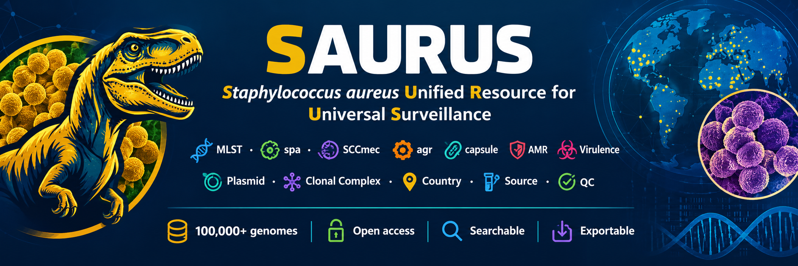

<div align="center">



# 🦖 SAURUS

**Staphylococcus aureus Unified Resource for Universal Surveillance**

*One database. Every typing module. Free and open.*

[](https://bbeckley-hub.github.io/saurus/)
[](LICENSE)
[](https://bbeckley-hub.github.io/saurus/)
[](https://bbeckley-hub.github.io/saurus/)
[]()

[**🏠 Home**](https://bbeckley-hub.github.io/saurus/) ·
[**🧬 Lineages**](https://bbeckley-hub.github.io/saurus/lineages.html) ·
[**📥 Downloads**](https://bbeckley-hub.github.io/saurus/downloads.html) ·
[**ℹ️ About**](https://bbeckley-hub.github.io/saurus/about.html)

</div>

---

## 📖 What is SAURUS?

**SAURUS** is an open-access genomic resource that integrates every major *Staphylococcus aureus* typing and gene-annotation scheme into a single, queryable interface:

| Category | Modules |
|---|---|
| **Typing** | MLST · spa · SCCmec (CGE + RPet) · agr · capsule |
| **Genes** | AMR · Virulence (VFDB) · Plasmid replicons |
| **Clinical** | MRSA/MSSA consensus |
| **Lineage context** | Curated catalogue of ~50 clonal complexes |
| **Retrieval** | Search → filter → export accession lists in one click |

No login, no API key, no install. Runs entirely in your browser over HTTPS.

> **The core deliverable is accession retrieval.** Every page lets you filter by genotype and download the exact list of genome accessions that match — ready to feed to `datasets download genome accession`.

---

## 🎯 Project goal — annotate all 126,245 public *S. aureus* genomes

SAURUS is being built incrementally toward a single milestone: **the complete annotation of every public *S. aureus* genome** in the NCBI Assembly database.

| Milestone | Scope | Status |
|---|---|---|
| **v0.1** | 20K RefSeq (GCF) genomes, 9 modules | ✅ **live** |
| **v0.2** | + Country · Source · Year metadata | 🔄 in progress |
| **v0.3** | Full 26,352 GCF genomes | 📋 planned |
| **v0.4** | + 100K GCA genomes with Shelenkov merge | 📋 planned |
| **v1.0** | **126,245 genomes · unified master table · citable resource** | 🎯 target |

See the [**Roadmap**](#-roadmap) below for details.

---

## ✨ Features

<table>
<tr><td width="50%" valign="top">

### 🔬 Interactive typing pages
- **Live search** with exact-match operators (`ST5`, `CC5`, `t002`)
- **Multi-column filters** — combine ST + SCCmec + agr + capsule + MRSA
- **Column visibility toggle** — persisted per browser
- **Row selection** with select-all-visible
- **Sortable columns** — numeric-aware for ST, CC, spa, SCCmec
- **Pagination** — 20 / 50 / 100 rows per page
- **Export** — TSV · CSV · JSON · **accession-only**

</td><td width="50%" valign="top">

### 🧬 Gene retrieval pages
- **Up to 5 genes per query**
- **ANY / ALL** match logic
- **Curated headline genes** for AMR, virulence, plasmid
- One-click **accession list export**
- **Click-to-copy** accession per row
- **Frequency table** — sortable, filterable, min-prevalence slider

</td></tr>
<tr><td valign="top">

### 📚 Lineage catalogue
- ~50 curated clonal complexes
- **Live sample counts** from the current dataset
- **Reference-only cards** for lineages with no samples yet
- **Export all accessions** per lineage
- Geographic + clinical + virulence context per CC

</td><td valign="top">

### 📥 Bulk downloads
- Every merged TSV available as `.tsv.gz`
- Row counts + file sizes at a glance
- **Long-format gene tables** — pivot-ready
- One-file-per-module layout

</td></tr>
</table>

---

## 🚀 Quick start

**Just visit the live site:**

### 👉 **https://bbeckley-hub.github.io/saurus/**

### Example workflow — get all ST5 MRSA blood isolates carrying *mecA* and PVL

1. Open [**Lineages**](https://bbeckley-hub.github.io/saurus/lineages.html) → click **CC5** → **Export accessions**
2. Open [**MRSA**](https://bbeckley-hub.github.io/saurus/pages/mrsa.html) → filter `MRSA Status = MRSA`, `CC = CC5`
3. Open [**AMR**](https://bbeckley-hub.github.io/saurus/pages/amr.html) → click **mecA** chip → narrow further
4. Click **🧬 Accessions** → save the `.txt` file
5. Feed it to NCBI:
   ```bash
   datasets download genome accession --inputfile accessions.txt
   ```
6. ✅ You have 10K+ genomes, filtered by genotype, on your laptop

---

## 🗺️ Roadmap

<details open>
<summary><b>v0.1 — Foundation (current)</b> ✅</summary>

- [x] 9 typing + gene modules live
- [x] Consistent nav across all 12 pages
- [x] CC column added to MLST and MRSA pages
- [x] Lineage catalogue with live sample counts
- [x] Bulk download index
- [x] GitHub Pages deployment
- **Dataset:** 20,000 RefSeq genomes · 13 CCs · ~600 STs

</details>

<details>
<summary><b>v0.2 — Epidemiological metadata</b> 🔄</summary>

- [ ] Fetch country + isolation source + host + collection year from NCBI BioSample
- [ ] Normalize free-text sources into categories (blood · wound · respiratory · nasal · food · animal · environment · clinical)
- [ ] Add **Country** and **Source** filter dropdowns to every typing page
- [ ] Add **Country × ST** and **Source × CC** cross-tab breakdowns to MRSA page
- [ ] New **Geography** page — world map of isolates by country
- [ ] New **Source** page — MRSA rate by isolation site

**Why this matters:** country + source is what turns a typing archive into an **epidemiological surveillance platform** — the version of SAURUS that gets cited.

</details>

<details>
<summary><b>v0.3 — Complete RefSeq coverage</b> 📋</summary>

- [ ] Run StaphScope on remaining 6,352 GCF genomes (batch 3 in progress)
- [ ] Extend all 9 modules to full **26,352 RefSeq** set
- [ ] Add **per-batch provenance** — users see which genomes came from which release

</details>

<details>
<summary><b>v0.4 — GenBank merge + full repository</b> 📋</summary>

- [ ] Process remaining **99,893 GCA genomes** from NCBI GenBank
- [ ] Merge with Shelenkov et al. (2025) dataset — 86,318 AMR/VF/plasmid annotations
- [ ] Resolve GCA ↔ GCF paired accessions
- [ ] Handle the ~**125** Shelenkov-only accessions (withdrawn from NCBI)
- [ ] **Deduplication pass** — remove identical isolates sequenced multiple times

</details>

<details>
<summary><b>v1.0 — Full resource</b> 🎯</summary>

- [ ] **126,245 genomes** with unified master table
- [ ] Cross-module filter UI — CC + SCCmec + agr + capsule + country + source + any gene
- [ ] Boolean query builder for advanced users
- [ ] **Zenodo DOI** for citable release
- [ ] Database article submitted (BMC Genomic Data / Database Oxford)

</details>

---

## 🧬 Data sources

<table>
<tr><th>Layer</th><th>Source</th><th>Coverage</th></tr>
<tr><td><b>Typing</b></td><td><a href="https://github.com/bbeckley-hub/staphscope-typing-tool">StaphScope v2.0.0</a> on RefSeq genomes</td><td>20,000 → 126K</td></tr>
<tr><td><b>AMR genes</b></td><td><a href="https://doi.org/10.1186/s12863-025-01363-w">Shelenkov et al. 2025</a></td><td>86,318 GCA</td></tr>
<tr><td><b>Virulence (VFDB)</b></td><td>Shelenkov et al. 2025</td><td>98,950 GCA</td></tr>
<tr><td><b>Plasmid replicons</b></td><td>Shelenkov et al. 2025</td><td>86,318 GCA</td></tr>
<tr><td><b>Lineage reference</b></td><td>Curated (literature-validated)</td><td>~50 CCs</td></tr>
<tr><td><b>Country / source</b> (v0.2)</td><td><a href="https://www.ncbi.nlm.nih.gov/biosample/">NCBI BioSample</a></td><td>~50–75% coverage</td></tr>
</table>

All genome identifiers use the standard **`GCA_XXXXXXXXX.Y`** or **`GCF_XXXXXXXXX.Y`** format.

---

## 📁 Repository structure

```
saurus/
├── README.md
├── LICENSE
├── images/
│   └── saurus_banner.png
└── docs/                          ← GitHub Pages site (source: main /docs)
    ├── .nojekyll
    ├── index.html                 ← landing page
    ├── about.html                 ← project + team + methods
    ├── lineages.html              ← curated CC catalogue
    ├── downloads.html             ← bulk data index
    ├── data/                      ← bulk TSV.gz downloads
    ├── pages/
    │   ├── mlst.html              ← MLST + CC
    │   ├── spa.html
    │   ├── sccmec.html            ← CGE + RPet + subtype tabs
    │   ├── capsule.html
    │   ├── agr.html
    │   ├── mrsa.html              ← comprehensive MRSA + CC breakdown
    │   ├── amr.html               ← gene retrieval
    │   ├── vfdb.html
    │   ├── plasmid.html
    │   └── data/                  ← gene retrieval JSON indexes
    └── ...
```

> `merged/`, `batches/`, and `scripts/` are git-ignored — they hold the local pipeline that runs on the HPC.

---

## 🛠️ Running locally

**Prerequisites:** Python 3.9+

```bash
git clone https://github.com/bbeckley-hub/saurus.git
cd saurus/docs
python3 -m http.server 8000
```

Open **http://localhost:8000/**.

> ⚠️ **HTTP required.** The gene retrieval pages use `fetch()` to load JSON. Browsers block this from `file://` URLs. Served over HTTP (or from GitHub Pages), it just works.

---

## 🧪 Regenerating pages

Each page is produced by a self-contained Python script. Given the merged TSVs in `merged/`:

```bash
cd merged/

# Typing pages
python3 generate_mlst.py      -i mlst_all.tsv              -o ../docs/pages/mlst.html
python3 generate_spa.py       -i spa_all.tsv               -o ../docs/pages/spa.html
python3 generate_agr.py       -i agr_all.tsv               -o ../docs/pages/agr.html
python3 generate_capsule.py   -i capsule_all.tsv           -o ../docs/pages/capsule.html
python3 generate_sccmec.py    -c sccmec_cge_all.tsv \
                              -r sccmec_rpet_all.tsv       -o ../docs/pages/sccmec.html
python3 generate_mrsa.py      --mlst mlst_all.tsv --spa spa_all.tsv \
                              --cge sccmec_cge_all.tsv --rpet sccmec_rpet_all.tsv \
                              --capsule capsule_all.tsv --agr agr_all.tsv \
                              --cc cc.txt                  -o ../docs/pages/mrsa.html

# Gene retrieval pages
python3 generate_gene_page.py --db all --dir . \
    --outdir ../docs/pages/ --datadir ../docs/pages/data

# Supporting pages
python3 generate_index.py      --dir . -o ../docs/index.html
python3 generate_about.py              -o ../docs/about.html
python3 generate_lineages.py           -o ../docs/lineages.html
python3 generate_downloads.py  --dir . -o ../docs/downloads.html
```

---

## 🤝 Contributing

We welcome:

- 🐛 **Bug reports** — [open an issue](https://github.com/bbeckley-hub/saurus/issues)
- 💡 **Feature suggestions** — [start a discussion](https://github.com/bbeckley-hub/saurus/discussions)
- 🧬 **Data corrections** — if you spot a lineage call that doesn't match the literature
- 📊 **New metadata sources** — geographic crosswalks, country name normalizations

Please keep pages **self-contained** (one script per page) and preserve the shared visual style.

---

## 📚 Citation

If you use SAURUS in your research, please cite the pipeline and the source gene dataset.

### Typing pipeline

> **Beckley B, Amarh V.** StaphScope: a species-optimized computational pipeline for rapid and accessible *Staphylococcus aureus* genotyping and surveillance. *BMC Genomics*. 2026;27:261.
> [doi:10.1186/s12864-026-12609-x](https://doi.org/10.1186/s12864-026-12609-x)

### Gene dataset

> **Shelenkov A, Slavokhotova A, Yunusova M, et al.** Genomic typing, antimicrobial resistance gene, virulence factor and plasmid replicon database for the important pathogenic bacteria *Staphylococcus aureus*. *BMC Genom Data*. 2025;26:65.
> [doi:10.1186/s12863-025-01363-w](https://doi.org/10.1186/s12863-025-01363-w)

### Cite SAURUS itself

> **Beckley B.** SAURUS: *Staphylococcus aureus* Unified Resource for Universal Surveillance. 2026.
> [github.com/bbeckley-hub/saurus](https://github.com/bbeckley-hub/saurus)

---

## 🙏 Acknowledgements

SAURUS stands on the shoulders of the open-source genomics community. We thank:

- **Brown Beckley & Vincent Amarh** — for StaphScope, the typing engine
- **Andrey Shelenkov & colleagues** — for publishing their gene dataset openly
- **Torsten Seemann** — for `mlst`, `ABRicate`, and a decade of pipeline standards
- **Robert A. Petit III** — for `sccmec` and `agrVATE` contributions
- **Center for Genomic Epidemiology (DTU)** — for `SCCmecFinder`
- **NCBI** — for the `datasets` CLI, AMRFinderPlus, and the Assembly/BioSample databases
- **PubMLST & Ridom** — for allele and spa-type reference databases
- **The Python scientific stack** — pandas, numpy, and every dependency in between

---

## 📄 License

**MIT License** — free to use, modify, and redistribute. Attribution appreciated.

See [LICENSE](LICENSE) for details.

---

<div align="center">

**Built with 🧬 at the University of Ghana Medical School**

*Turning fragmented genomic data into coherent biological narratives.*

**[⭐ Star this repo](https://github.com/bbeckley-hub/saurus)** if you find it useful.

</div>
